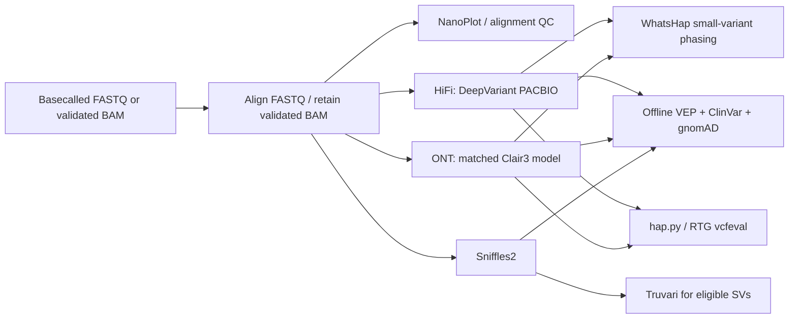

# Long-read variant pipeline

Reproducible **human germline PacBio HiFi and Oxford Nanopore WGS** analysis
from basecalled reads through variant calling, phasing, offline annotation,
and truth-set benchmarking. Companion repository:
[short-read-variant-pipeline](https://github.com/Homabazireh/short-read-variant-pipeline).



## Quick start

Prerequisites: Linux, Python 3.10+, Java 21, samtools, bcftools, and Apptainer
(or a working Docker daemon). The default execution path uses CPUs.

```bash
bash scripts/install_nextflow.sh
export PATH="$PWD/.tools:$PATH"
bin/doctor --profile apptainer
```

Prepare the sample CSV (one file per sample; platform is `hifi` or `ont`):

```csv
sample,platform,reads,chemistry,basecaller,model
HG002,hifi,/data/HG002.hifi.fastq.gz,,,
```

Create a reference resource JSON:

```json
{
  "schema_version": 1,
  "genome_build": "GRCh38",
  "reference_fasta": "/references/GRCh38.fa",
  "reference_sha256": "REPLACE_WITH_THE_REFERENCE_SHA256"
}
```

The uncompressed reference must have an adjacent `.fai`. Existing BAMs require
compatible reference dictionaries, coordinate sorting, and sample/platform read
groups. ONT additionally requires explicit chemistry, basecaller, and a local
compatible model with checksummed metadata; see the [long-read guide](docs/long-read-workflow.md).

```bash
bin/run --input samples.csv --resources resources.json \
  --outdir /analysis/long-read-01 --profile apptainer \
  --cpus 16 --memory-gb 64 --dry-run

bin/run --input samples.csv --resources resources.json \
  --outdir /analysis/long-read-01 --profile apptainer \
  --cpus 16 --memory-gb 64
```

For Slurm add `--executor slurm --queue PARTITION`. Continue matching runs using
`--resume`. `--regions intervals.bed` limits a run to declared autosomal intervals;
record the same scope when benchmarking.

## Annotation and benchmarking

The calling workflow writes `calls.csv`. Configure the VEP cache, ClinVar and
gnomAD resources, then annotate independently:

```bash
bin/annotate --input /analysis/long-read-01/calls.csv \
  --resources resources.json --outdir /analysis/long-read-01-annotation \
  --profile apptainer --cpus 8 --memory-gb 32

bin/benchmark --input benchmark.csv --resources resources.json \
  --outdir /analysis/long-read-01-benchmark --profile apptainer \
  --cpus 8 --memory-gb 32
```

The benchmark CSV has `sample,label,vcf,variant_type,truth_vcf,truth_bed` columns.
Use matched GIAB truth/reference data and `--regions` for interval-limited runs.
Truvari evaluates eligible sequence-resolved insertions/deletions, with other
SV classes reported separately. See [benchmarking](docs/benchmarking.md).

## Outputs and support boundary

- Sorted/indexed alignments, read QC, mapping statistics and coverage.
- Small-variant VCF/gVCF, phased VCF, haplotagged BAM, and WhatsHap statistics.
- Sniffles SV VCF/SNF, annotated VCF/TSV, native benchmark outputs, summary
  JSON/CSV/HTML, tool/model/resource metadata and execution traces.

Initial validated calling is **GRCh38 autosomal germline**. Raw POD5/FAST5
basecalling, CCS generation, methylation, assembly, sex-chromosome ploidy,
mitochondrial variants, repeat expansions, somatic analysis and cohort joint
genotyping are outside this release. WhatsHap phasing applies to small variants;
SV phasing is not claimed. No Illumina duplicate marking or BQSR is applied to
long reads. This is a research workflow with explicit measured validation scope.

## Documentation and verification

- [Long-read workflow and ONT model contract](docs/long-read-workflow.md)
- [Annotation](docs/annotation.md) and [benchmarking](docs/benchmarking.md)
- [Reference and resource preparation](docs/resources.md)
- [Measured validation status](docs/validation.md)
- [Third-party projects, licenses and data](THIRD_PARTY.md)

Run `python3 -m unittest discover -s tests -v` for automated validation and
report-parser tests. Actual public-data execution results are recorded separately
from tests and are not presented as whole-genome performance unless measured.

Core callers: [DeepVariant](https://github.com/google/deepvariant),
[Clair3](https://github.com/HKU-BAL/Clair3),
[Sniffles](https://github.com/fritzsedlazeck/Sniffles).
